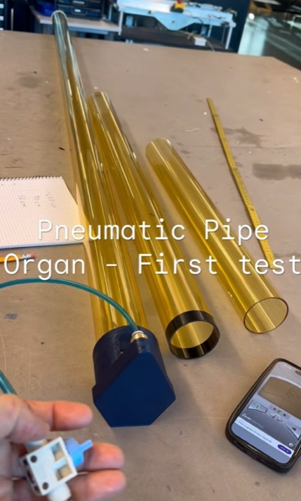
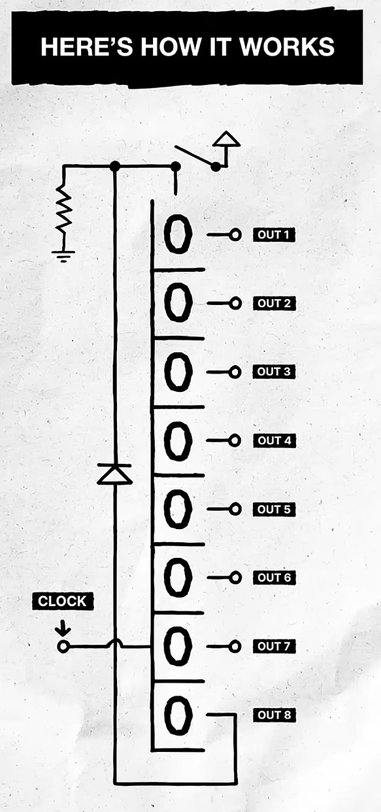

# What is it
A bare bones digital signal sequencer. Used to make music loops on homemade instruments. One channel per card and a common clock card.

# Motivation

I want it to run my Pipe Organ, I have a [12 valve pneumatic manifold ready to go.](Images/manifold_and_cable.jpg)

- [Pneumatic pipe organ- First test](https://youtube.com/shorts/L7J5WPEUMWw?si=k-WOeQEzKxhjgEyd)

I considered using Siemens logo PLCs but it doesn't seem well suited. ([See Use-A-PLC?](#use-a-plc) or [Use-A-Microcontroller](#use-a-microcontroller)) I want to prioritize working with my hands and avoid sitting infront of a computer for much of the project.

## Inspiration 

Moriz Kleins shows how you can use a shift register IC to make a looping interactive sequence. I want to make one for each note on the Organ.

- [Moriz Kleins Super simple drum sequencer (4 parts)](https://www.youtube.com/shorts/7boGHtppE2U)

Possibly use double length shift registers for 16 bit resolution.

## Electronic strategy

# BOM
- Shift registers
- (555)-Timer or other square wave generator
- Potentiometer to control loop scan speed
- LEDs to view the queue (optional but fun, makes it a ton of work.)

### Card pins
- Switch signal in
- Note signal out

### Master pins
- Clock speed
- Reset all
- Scan on/off
- VCC
- GND

### Common pins stack
- Clock
- Reset all
- VCC
- GND

### Open questions

- Will it have Clear 1 channel memory feature (uniqe button or combo press?)
- 24V output on card or not, selectanble? Transistor output might be good. Remember freewheel diodes.
- Power, perhaps I should run it on a 24V VCC with a 5V switching regulator on the master card?

Optocoupler option:
- [Solid state relay, optocoupler TOP 5VDC/48VDC 0,5A](https://eshop.weidmueller.com/en/top-5vdc48vdc-05a/p/8950960000)

Thoughts
- Shared input and output pin would be cool but there is a significant risk of self latching. Perhaps if the out is 5V and stepped up later through an input that takes many different voltages like the optocoupler?

## Use a PLC?
I have made a LogoSoft progam with 4 shift registers to test the general idea. Seems to work fine. But the software caps the use of shift registers at 4, which is insulting. I probably need 24. 

 - [Jpg of Code with  standard registers](Images/logo_4_standard_shifts.jpg)
 - [LogoSoft code 4 standard registers](PLC_code/Shift_register_Organ_4_standard_regs.lsc)
 

I have also tested out making my own shift registers as a workaround.

- [3 step RD register JPG](Images/logo_3_step_RS_register.jpg)
- [3 step RD register LogoSoft PLC code](PLC_code/Shift_register_Organ_RS_as_3_step_loop_register.lsc)

 Now when I have that working I can put them in UserDefinedFunctions to make the Code as compact and readable as with the standard shift registers (max 64  UDFs per program with limited IOs per UDF...) but the scan speed of the Logo-programs is potentially silly slow, I read specs of 22-30ms so its not promising. Might do it anyway as an exercise. A HMI would have to be used to display the queues, as the PLC does not have enough IOs and the UDFs might max out anyway. The UDF test files in this repo are work in progress and does not work properly yet. I might have to add M flags to make them iterate correctly, but the number of flags is also limited so... Probably best to not do it on the PLC.  

## Use a microcontroller?
I could use an arduino and code the shift registers. But if I wanted the queue visualisation it would require programming graphics on a screen or adding shift registers for up to ~200 leds which sounds like a detour compared to just using them directly. I want to minimise the time spent by a computer so solving it with hardware is preferable